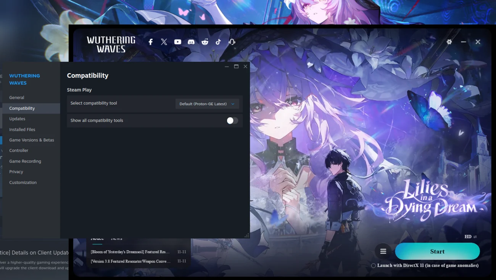

# Blank Wuthering Waves launcher fix (Linux/Proton)

## Requirements

- Linux with Python 3 installed (`python3 --version` to check).
- Steam version of Wuthering Waves and its `launcher_main.dll`.
- Close the game/launcher before running the script.
- No third-party Python packages, root access, or elevated permissions required; you need write access to the game’s version folder.

## Apply the fix

1. Exit Wuthering Waves in Steam.
2. Right-click the game in your Steam library → **Manage → Browse local files**.
3. Open the current numbered version folder containing `launcher_main.dll` (beside `launcher_main.exe`).
4. Put `patch_wuthering_waves_launcher.py` in that folder.
5. Open a terminal there and run:
   ```bash
   python3 patch_wuthering_waves_launcher.py ./launcher_main.dll
   ```
6. Launch the game. The script creates a `.bak` backup next to the DLL.



If it says the marker is missing, stop and check that you selected the current version folder. Repeat the steps if a launcher update replaces the DLL.

## Undo

1. Exit Wuthering Waves in Steam.
2. In the same version folder, restore the backup over the patched DLL:
   ```bash
   cp -p launcher_main.dll.bak launcher_main.dll
   ```
   If the script created a numbered backup (for example `launcher_main.dll.bak.1`), use that exact filename instead.
3. Launch the game again.
